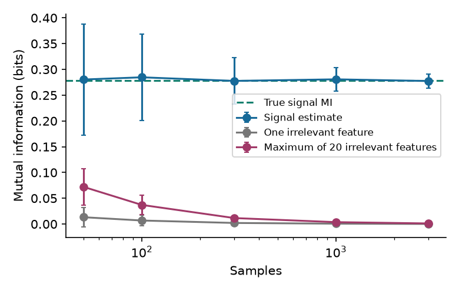
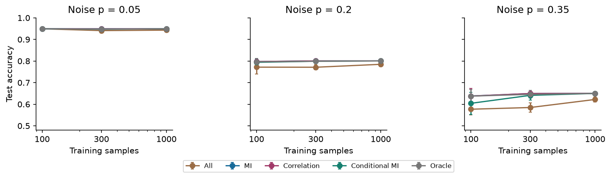
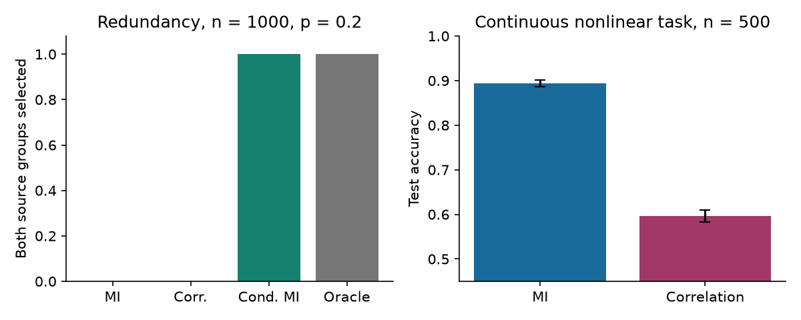

# Entropy and Mutual Information in Modern Machine Learning

**Graduate Course Project — Information Theory**  
**Full topic:** *Estimation, Interpretation, and Limits*

## Overview

This project examines how entropy and mutual information (MI) can be used to measure dependence between features and classification labels. I focused on three questions: how accurately MI can be estimated from limited data, how it should be interpreted in feature selection, and when an informative feature does not lead to better classification accuracy.

I used Python to generate controlled synthetic datasets, compare feature-selection methods, and measure the resulting classification performance. The experiments cover binary observation noise, redundant features, finite-sample estimation, and nonlinear dependence. The report also discusses neural MI estimation, information bottleneck methods, and contrastive learning from a theoretical perspective; these neural methods are not implemented in the code.

## Experiments

- **MI estimation:** Compare estimated MI with a known theoretical value as sample size changes, including spurious MI estimates from unrelated features.
- **Feature selection:** Compare marginal MI, correlation, greedy conditional MI, and a reference selection using a decision-tree classifier.
- **Redundancy:** Examine what happens when a dataset contains an exact duplicate and a noisy copy of an informative feature.
- **Nonlinear dependence:** Test whether MI can identify a useful feature that has zero population Pearson correlation with the label.
- **Interaction limits:** Use an XOR example to explain why individual feature scores can miss information that appears only when features are considered together.

## Selected results

- In the synthetic nonlinear experiment, MI-based selection achieved **89.32%** mean test accuracy, compared with **59.66%** for correlation-based selection.
- In the binary redundancy experiment with 1,000 training samples and noise probability 0.2, conditional MI recovered both independent feature sources in **30 out of 30 trials**. Marginal MI did not recover both sources in those trials.
- Recovering additional information did not improve hard classification accuracy in that binary setting, illustrating the difference between information gain and prediction accuracy.

The experiments use generated data, not a collected real-world dataset. Results are specific to the models and evaluation settings described in the report.

## Figures

**Finite-sample MI estimation**



**Classification accuracy at different noise levels**



**Feature redundancy and nonlinear classification**



## Run the experiments

Use Python 3.12 for the closest match to the recorded environment.

```bash
python -m pip install -r requirements.txt
python experiment.py
```

The script regenerates the CSV result files and figures in `figures/`. It does not require an external dataset or a GPU. Package versions from the original run are recorded in `environment.json`.

## Project files

| File | Contents |
| --- | --- |
| [`experiment.py`](experiment.py) | Dataset generation, MI estimation, feature selection, and evaluation |
| [`report.pdf`](report.pdf) | Full eight-page IEEE-style course project report |
| [`report.tex`](report.tex) | LaTeX source for the report |
| `classification_runs.csv`, `classification_summary.csv` | Binary classification trial results and summary statistics |
| `estimation_runs.csv` | Finite-sample MI estimation trials |
| `nonlinear_runs.csv` | Nonlinear feature-selection trials |
| `stability.csv` | Feature-selection stability statistics |
| [`figures/`](figures/) | Generated plots in PNG and PDF formats |
| `requirements.txt`, `environment.json` | Python dependencies and recorded environment |
| `IEEEtran.cls` | LaTeX class used to format the report |

To compile the report, run `pdflatex report.tex` twice in a LaTeX installation with the required packages available.
